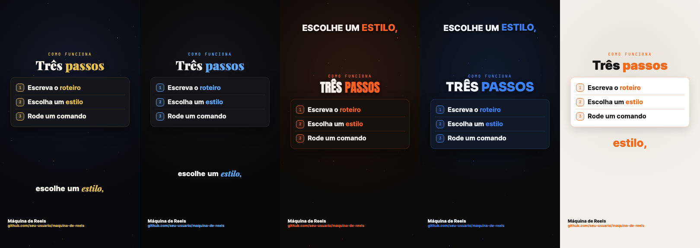
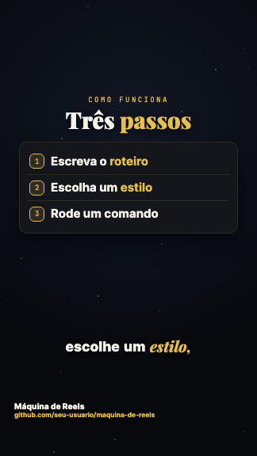
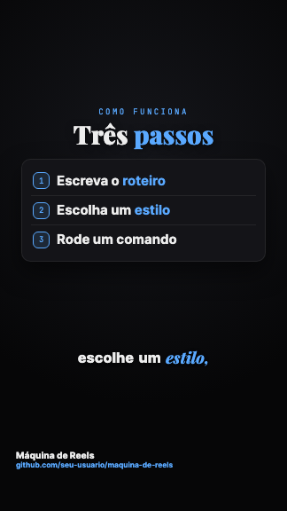
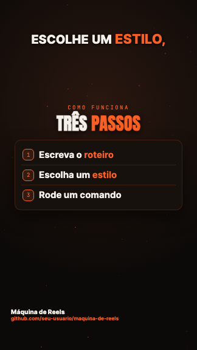
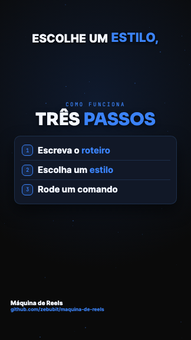
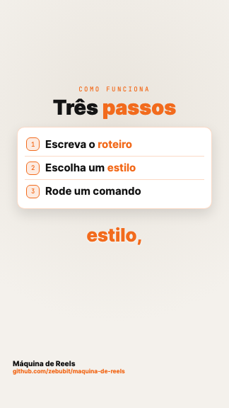

# Máquina de Reels 🎬

[Português](README.md) · **English**

Create **narrated reels in Brazilian Portuguese** from a text script: voiceover, word-by-word captions and animations, all in code. No video editor, no AI video credits.

You write the lines in a `roteiro.json` file, pick a style and run one command. You get a vertical 1080x1920 MP4 ready for Instagram, TikTok and YouTube Shorts.



## Why it exists

Small local businesses in Brazil (barbershops, clinics, restaurants) need short videos every week but can't afford agencies or paid AI video tools, and most open-source video tooling assumes English. Máquina de Reels is built for them: Portuguese voices, Portuguese pronunciation fixes, Portuguese docs, and a free path from script to finished video.

## What it does

- **Free Portuguese voice** (Edge neural voices), or your cloned voice on ElevenLabs, or **your own recording**.
- **Word-by-word captions** synced to the speech, with highlighted words.
- **6 scene types**: title, list, animated number, chat conversation, photo and call to action ("Comment WORD").
- **Styles in JSON**: colors, fonts, caption position and animation type. Changing the whole look is a one-line change.

## Getting started in 3 minutes

Requires [Node.js](https://nodejs.org) 20 or newer.

```bash
git clone https://github.com/zebubit/maquina-de-reels.git
cd maquina-de-reels
npm install

# renders the example video (free voice)
node cli/index.mjs criar exemplos/primeiro-reels --render
```

The video is saved to `exemplos/primeiro-reels/saida/primeiro-reels.mp4`. The first time, Remotion downloads an internal browser (about 90 MB).

### Your first video

```bash
node cli/index.mjs novo my-video              # creates my-video/roteiro.json
# edit the lines in roteiro.json
node cli/index.mjs criar my-video --previa    # one frame per scene, for a quick check
node cli/index.mjs criar my-video --sem-voz --render   # final video, without generating the voice again
```

Commands (the CLI is in Portuguese):

| Command | What it does |
|---|---|
| `novo <folder>` | creates a folder with an example script |
| `criar <folder> --previa` | generates voice and captions and saves one frame per scene in `saida/previa/` |
| `criar <folder> --render` | renders the final video |
| `criar <folder> --sem-voz` | reuses the narration already generated (no extra credits) |
| `criar <folder> --estilo azul-tech` | switches the style without touching the script |
| `estilos` | lists the styles and who made each one |

## The script

```json
{
  "slug": "my-video",
  "estilo": "dourado-noturno",
  "voz": {"provedor": "edge", "nome": "pt-BR-AntonioNeural"},
  "destaques": ["grátis", "código"],
  "pronuncia": {"CRM": "cê erre eme"},
  "assinatura": {"nome": "Your Name", "handles": "@yourprofile", "foto": "me.jpg"},
  "cenas": [
    {"tipo": "titulo", "fala": "What the voice says in this scene.", "icone": "🎬", "titulo": "Made with *code*", "sub": "smaller text"},
    {"tipo": "card", "fala": "...", "kicker": "how it works", "titulo": "Three *steps*", "itens": ["One", "Two", "Three"]},
    {"tipo": "numero", "fala": "...", "valor": 100, "prefixo": "", "sufixo": "%", "rotulo": "in Portuguese", "barra": 100},
    {"tipo": "chat", "fala": "...", "titulo": "Support", "msgs": [{"de": "cliente", "txt": "Hi!"}, {"de": "ia", "txt": "Hello!"}]},
    {"tipo": "foto", "fala": "...", "imagem": "photo.jpg", "titulo": "With a *photo*"},
    {"tipo": "cta", "fala": "Comment REELS and I'll send it to you.", "palavra": "REELS", "sub": "and I'll send you the link"}
  ]
}
```

- The **fala** (line) of every scene, in order, becomes the narration. Each scene starts when its first word is spoken.
- `*word*` in titles, subtitles and items is shown in the highlight color.
- `pronuncia` changes only what the voice says; the caption shows the original text.

### Voices

| Provider | Cost | How to use |
|---|---|---|
| `edge` | free | `{"provedor": "edge", "nome": "pt-BR-AntonioNeural"}` (or `pt-BR-FranciscaNeural`) |
| `elevenlabs` | paid | `{"provedor": "elevenlabs", "id": "<voice_id>"}` and the `ELEVENLABS_API_KEY` variable |
| `arquivo` | free | `{"provedor": "arquivo", "arquivo": "my-voice.m4a"}`: word timings are found with Whisper, on your own computer (the first time it downloads and builds Whisper and a ~500 MB model) |

The `edge` voice uses an unofficial Microsoft service and may change without notice. For serious commercial use, prefer ElevenLabs or your own recording.

## Styles

| | | |
|---|---|---|
| <br>`dourado-noturno` | <br>`escuro-minimal` | <br>`laranja-impacto` |
| <br>`azul-tech` | <br>`creme-claro` | **yours?**<br>[see how to send it](CONTRIBUTING.md) |

## Contribute a style in 5 minutes

No coding needed: a style is a JSON file with colors and fonts, and your handle shows up as its author. Step by step in [CONTRIBUTING.md](CONTRIBUTING.md) (in Portuguese; issues and pull requests in English are welcome too). Looking for something to start with? See the [good first issues](https://github.com/zebubit/maquina-de-reels/labels/good%20first%20issue).

## Tweaking the visuals

Run `npm run estudio` to open Remotion Studio and watch the example video live while you edit `remotion/src/Reels.tsx`.

## License

This project's code is **MIT**: use, modify and sell it freely.

The video is assembled with [Remotion](https://www.remotion.dev), which has its own license: it is **free for individuals and companies with up to 3 employees**. Larger companies need a [Remotion company license](https://www.remotion.dev/license).

Made in Brazil by [@dionefol](https://instagram.com/dionefol) and contributors.
