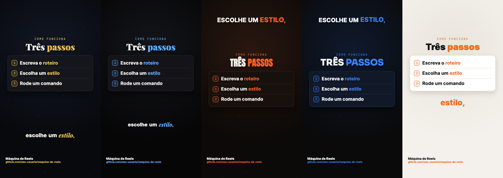
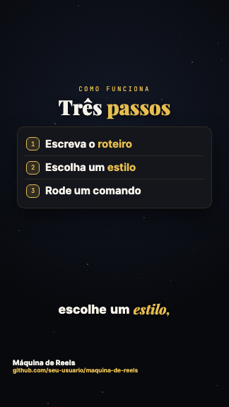
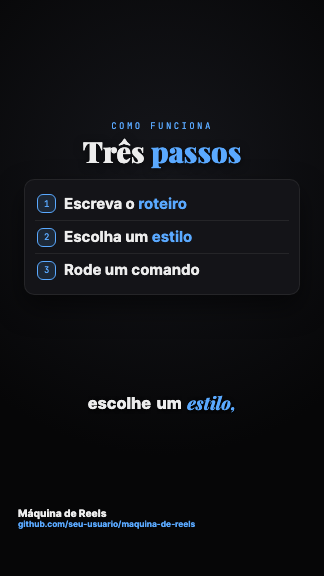
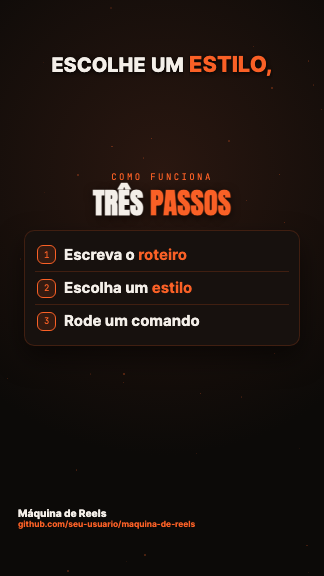
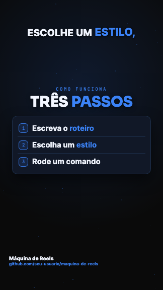
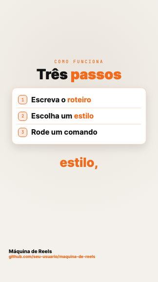

# Máquina de Reels 🎬

Crie **reels narrados em português** a partir de um roteiro de texto: voz, legenda palavra por palavra e animações, tudo em código. Sem editor de vídeo, sem crédito de IA de vídeo.

Você escreve as falas num arquivo `roteiro.json`, escolhe um estilo e roda um comando. Sai um MP4 vertical 1080x1920 pronto pro Instagram, TikTok e YouTube Shorts.



## O que ela faz

- **Voz grátis em português** (vozes neurais do Edge), ou a sua voz clonada na ElevenLabs, ou a **sua própria gravação**.
- **Legenda palavra por palavra** sincronizada com a fala, com palavras de destaque.
- **6 tipos de cena**: título, lista, número animado, conversa de chat, foto e chamada final ("Comenta PALAVRA").
- **Estilos em JSON**: cores, fontes, posição da legenda e tipo de animação. Trocar o visual inteiro é mudar uma linha.

## Começando em 3 minutos

Precisa do [Node.js](https://nodejs.org) 20 ou mais novo.

```bash
git clone https://github.com/SEU-USUARIO/maquina-de-reels.git
cd maquina-de-reels
npm install

# gera o vídeo de exemplo (voz grátis)
node cli/index.mjs criar exemplos/primeiro-reels --render
```

O vídeo sai em `exemplos/primeiro-reels/saida/primeiro-reels.mp4`. Na primeira vez o Remotion baixa um navegador interno (uns 90 MB).

### Seu primeiro vídeo

```bash
node cli/index.mjs novo meu-video          # cria meu-video/roteiro.json
# edite as falas no roteiro.json
node cli/index.mjs criar meu-video --previa  # um quadro de cada cena, pra conferir rápido
node cli/index.mjs criar meu-video --sem-voz --render   # vídeo final, sem gerar a voz de novo
```

Comandos:

| Comando | O que faz |
|---|---|
| `novo <pasta>` | cria uma pasta com um roteiro de exemplo |
| `criar <pasta> --previa` | gera voz e legenda e salva um quadro por cena em `saida/previa/` |
| `criar <pasta> --render` | gera o vídeo final |
| `criar <pasta> --sem-voz` | reaproveita a narração já gerada (não gasta crédito) |
| `criar <pasta> --estilo azul-tech` | troca o estilo sem mexer no roteiro |
| `estilos` | lista os estilos e quem fez cada um |

## O roteiro

```json
{
  "slug": "meu-video",
  "estilo": "dourado-noturno",
  "voz": {"provedor": "edge", "nome": "pt-BR-AntonioNeural"},
  "destaques": ["grátis", "código"],
  "pronuncia": {"CRM": "cê erre eme"},
  "assinatura": {"nome": "Seu Nome", "handles": "@seuperfil", "foto": "eu.jpg"},
  "cenas": [
    {"tipo": "titulo", "fala": "O que a voz diz nessa cena.", "icone": "🎬", "titulo": "Feito com *código*", "sub": "texto menor"},
    {"tipo": "card", "fala": "...", "kicker": "como funciona", "titulo": "Três *passos*", "itens": ["Um", "Dois", "Três"]},
    {"tipo": "numero", "fala": "...", "valor": 100, "prefixo": "", "sufixo": "%", "rotulo": "em português", "barra": 100},
    {"tipo": "chat", "fala": "...", "titulo": "Atendimento", "msgs": [{"de": "cliente", "txt": "Oi!"}, {"de": "ia", "txt": "Olá!"}]},
    {"tipo": "foto", "fala": "...", "imagem": "foto.jpg", "titulo": "Com *foto*"},
    {"tipo": "cta", "fala": "Comenta REELS que eu te mando.", "palavra": "REELS", "sub": "que eu te mando o link"}
  ]
}
```

- A **fala** de todas as cenas, em ordem, vira a narração. Cada cena começa quando a primeira palavra dela é dita.
- `*palavra*` em título, subtítulo e itens fica na cor de destaque.
- `pronuncia` muda só o que a voz fala; a legenda mostra o texto original.

### Vozes

| Provedor | Custo | Como usar |
|---|---|---|
| `edge` | grátis | `{"provedor": "edge", "nome": "pt-BR-AntonioNeural"}` (ou `pt-BR-FranciscaNeural`) |
| `elevenlabs` | pago | `{"provedor": "elevenlabs", "id": "<voice_id>"}` e a variável `ELEVENLABS_API_KEY` |
| `arquivo` | grátis | `{"provedor": "arquivo", "arquivo": "minha-voz.m4a"}`: a máquina descobre o tempo de cada palavra com o Whisper, no seu computador (na primeira vez baixa ~500 MB) |

A voz `edge` usa um serviço não oficial da Microsoft e pode mudar sem aviso. Pra uso comercial sério, prefira a ElevenLabs ou a sua gravação.

## Estilos

| | | |
|---|---|---|
| <br>`dourado-noturno` | <br>`escuro-minimal` | <br>`laranja-impacto` |
| <br>`azul-tech` | <br>`creme-claro` | **o seu?**<br>[veja como mandar](CONTRIBUTING.md) |

## Contribua com um estilo em 5 minutos

Não precisa saber programar: um estilo é um arquivo JSON com cores e fontes. Seu @ aparece como autor. O passo a passo está no [CONTRIBUTING.md](CONTRIBUTING.md).

## Mexendo no visual

Rode `npm run estudio` pra abrir o Remotion Studio e ver o vídeo de exemplo ao vivo enquanto mexe em `remotion/src/Reels.tsx`.

## Licença

O código deste projeto é **MIT**: use, modifique e venda à vontade.

O vídeo é montado com o [Remotion](https://www.remotion.dev), que tem licença própria: é **grátis pra pessoas físicas e empresas com até 3 funcionários**. Empresas maiores precisam de uma [licença de empresa do Remotion](https://www.remotion.dev/license).

Feito no Brasil por [@dionefol](https://instagram.com/dionefol) e colaboradores.
